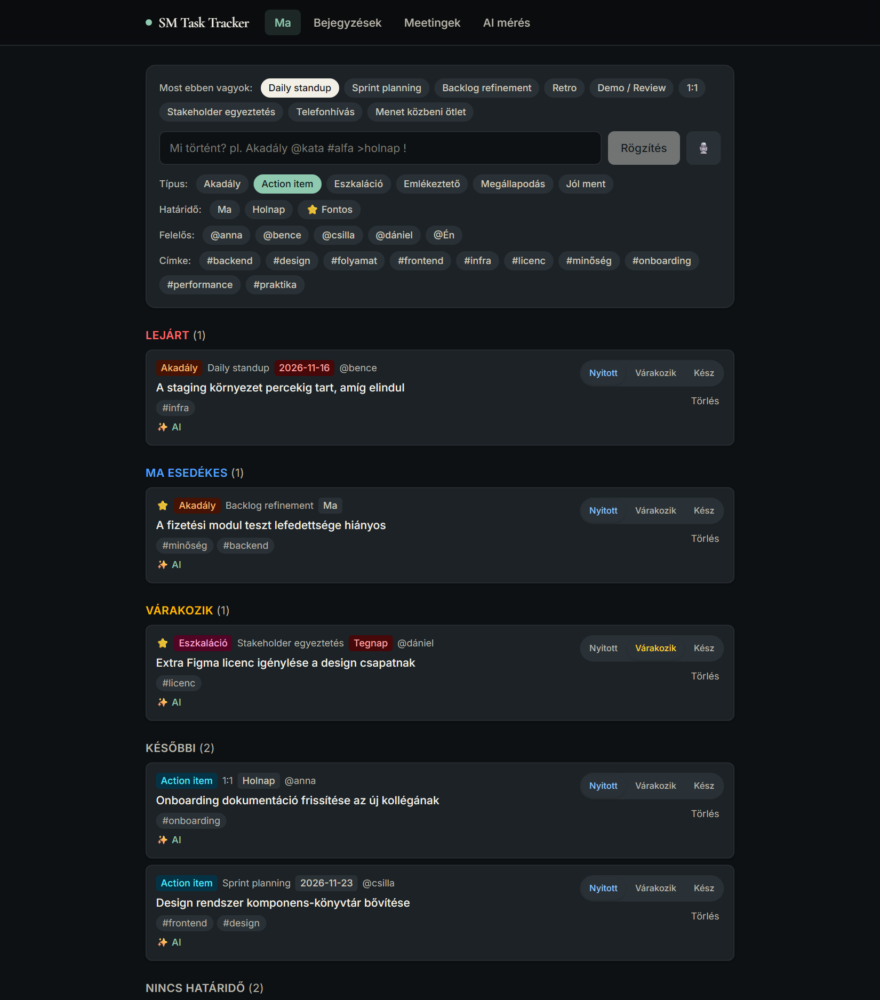
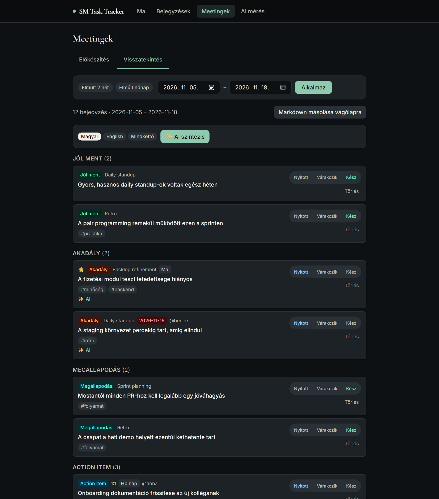
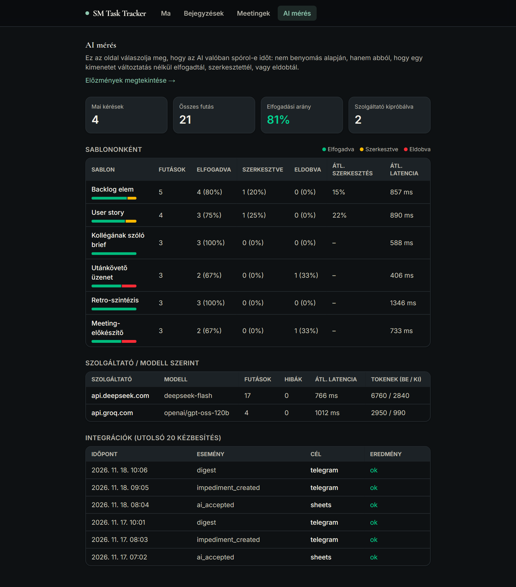
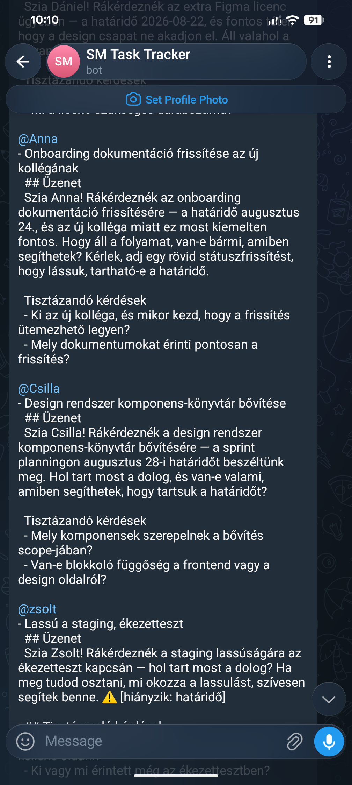
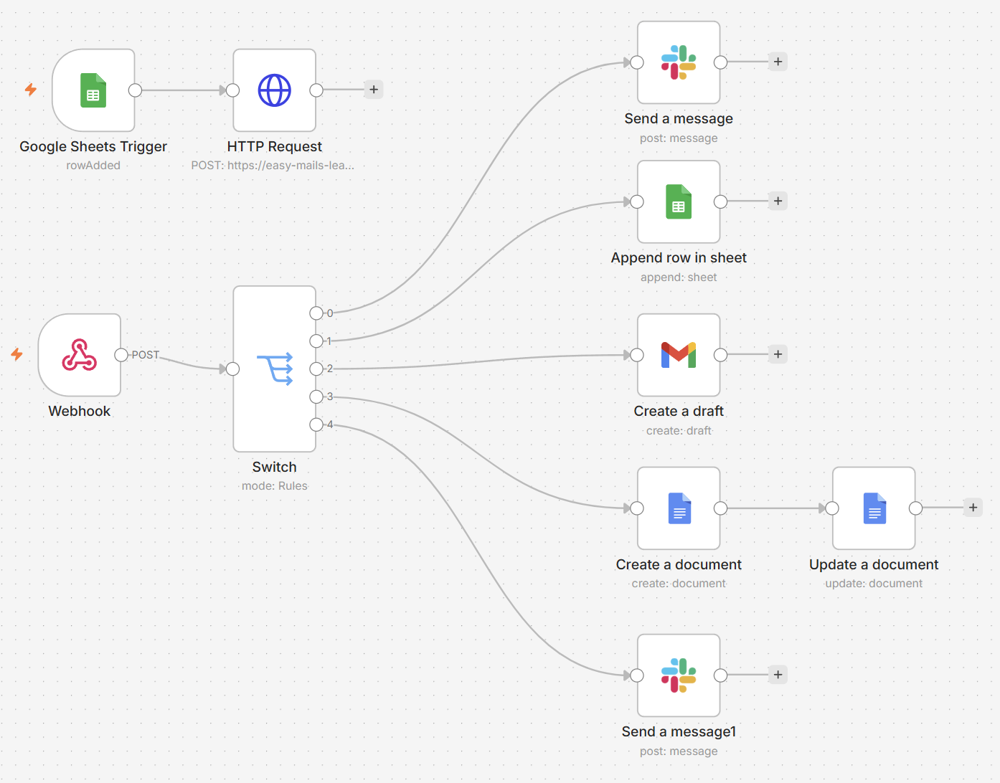

# SM Task Tracker

A one-line quick-capture and measurement layer for agile team leads — not a
Jira replacement, but a note you capture in a single line, in five seconds,
during a meeting. AI turns it into a usable artifact, and the app
**measures** whether the AI is actually saving time, instead of just
assuming it is.

A single-user project built for personal use that also doubles as a
full-stack technical showcase: data modeling, provider-independent AI
integration, a measurement layer, security, and outbound/inbound
integrations — **now all in our own code, with no external automation
platform**.

*(The interface itself is in Hungarian — it was built for the author's own
day-to-day use as a team lead. The screenshots below reflect that.)*

> **AI-assisted development.** This project was built in an AI-assisted
> workflow (Claude Code): I made the decisions on requirements, trade-offs
> and verification, and wrote the code together with the AI assistant, in
> phases, with tests and reviews.

---

## A new level: solved in code, securely, and tidily

The first version delegated external connections (Slack, Google Sheets,
Gmail, Google Docs) to an n8n automation platform. It worked quickly, but
the integration logic lived outside the application: untestable, outside
version control, a hidden dependency. The step up was moving **everything
into code**, and four things visibly improved along the way:

**1. No more automated wiring — everything is code.** Outbound and inbound
integrations live in the repo, are tested and versioned. The n8n version is
archived (see the bottom of this page), its last working state preserved in
a git tag.

**2. Better security.**
- The live demo sits behind a password gate and **fails closed** on a
  misconfiguration (it never silently opens up).
- Login brute-force protection that lives in the database (memory doesn't
  persist in a serverless environment), with atomic attempt counting.
- Every Server Action **checks the session itself** and validates input with
  `zod` — the proxy is not the only line of defence.
- The inbound endpoint (Google Form) is protected by an **HMAC-SHA256
  signature**, not the password gate; AI prompts no longer ship in the
  browser bundle, guarded by an automated test.
- The critical parts (login, signature verification) went through a separate
  security review, which found a real bug that was then fixed.

**3. Tidy API keys.** The AI layer's primary provider is DeepSeek, with Groq
as fallback and for speech transcription; the three previous providers' keys
are gone. Every variable is documented in a version-controlled
`.env.example` (no values), secrets are managed in matched pairs, and the old
keys have been revoked. The `/insights` page shows runs and errors per
provider.

**4. Better runtime quality.** 313 automated tests (52 before the rework),
fixed `Europe/Budapest` date handling (so "today" doesn't slip after
midnight), atomic database writes, voice-capture fixes (error handling,
length and size limits), a new dark theme, a mobile-friendly layout, and
Retro and Meeting prep merged into a single **Meetings** menu.

---

## The problem

An agile team lead's day is full of scattered notes — an impediment that
comes up mid-daily, an action item mentioned in a 1:1, a decision made
after a retro. These either get lost, or end up in some separate tool
(a notebook, a Slack DM to yourself) they never leave — never becoming a
backlog item, a message to the right owner, or a meeting agenda.

## The solution

**Single-line quick capture**, with built-in syntax:

```
Akadály @kata #alfa-csapat >holnap !
```

*(Impediment @kate #alpha-team >tomorrow !)* — `@` marks the owner, `#` the
tag, `>` the due date, `!` importance — plus a context switcher ("what I'm
in right now: daily / 1:1 / retro / …"), so nothing needs to be re-entered
mid-meeting.



---

## Meetings: preparation and look-back in one place

The `/meetings` menu has two tabs: **Preparation** (an AI agenda built from
open impediments and action items) and **Look-back** (retro, by period,
grouped by type, with AI synthesis and markdown export).



---

## The AI layer: not "there's AI," but *measured to see if it's worth it*

One click turns a note into a user story, backlog item, colleague brief, or
follow-up message; in the retro view, an AI synthesis surfaces recurring
themes and impediments.

**The key decision**: every AI output goes through a review panel
(editable, Accept/Discard) — the AI *never* writes anything to the app
automatically. That's not just a safety net, it's the basis for the
measurement: every decision is logged (accepted / edited / discarded, how
much the text changed), so the `/insights` page can answer, with data,
whether the AI is actually saving time.

**Provider-independent**: an OpenAI-compatible wire format, with automatic
switching between the primary (DeepSeek) and fallback (Groq) provider on
quota, authorization or server errors. Every run is logged with the provider
and model name, so the page also shows which model performs better on the
author's own notes. The bottom of the page lists the latest integration
deliveries.



**Voice capture** builds on the same principle: several remarks spoken in one
short recording become separate candidate entries (type, owner, tag, due
date); you Accept or Discard each one, and the decision feeds the
measurement. A two-step AI call (Whisper-compatible transcription, then
structuring) is behind it.

---

## Native integrations (replacing n8n)

Events leave through the `lib/integrations/` layer: one event type, one
routing row and one *sink* (target) per new delivery. Delivery runs in the
background after the save (it never slows capture down), failures are
recorded in an `integration_log` table, and `/insights` shows them.

| Direction | Event | Target |
|---|---|---|
| Out | Impediment saved | **Telegram** message |
| Out | Accepted backlog item | **Google Sheets** row (service account, no external package, own JWT signing) |
| Out | Accepted meeting prep | **Telegram** message |
| Out | Daily summary | **Telegram**, triggered by Vercel Cron |
| In | Google Form (a team member's impediment) | **Apps Script** → HMAC-signed request → entry in the app |

### Telegram daily summary

The daily digest shows, in one message, **who needs to watch what**: for
every open or waiting item that has an owner, the AI writes a short,
ready-to-send follow-up message, and the digest is grouped by @name,
overdue items first. On a phone, without opening the app, you can see who
owes what. It runs once a day, and `integration_log` records that it ran.



### The Google Form side

Team members can flag an impediment without opening the app, through a
Google Form. On submit, an Apps Script sends the body as plain-ASCII JSON,
signed with `HMAC-SHA256(secret, timestamp + "." + body)`, to the app's
inbound endpoint. The app verifies the signature and the timestamp,
idempotently creates the Impediment entry keyed by the response ID, and
notifies via Telegram. The signature doesn't depend on character encoding,
because accented text travels as `\uXXXX` escapes.

---

## Tech stack

- **Next.js 16** (App Router, Server Actions, Route Handlers) + TypeScript
- **Tailwind CSS v4**, a custom dark theme with semantic tokens
- **Drizzle ORM** + libSQL (SQLite locally, [Turso](https://turso.tech) in the cloud)
- **[Vitest](https://vitest.dev)** — 313 tests (parser, dates, AI runs, login, authorization, HMAC, client-bundle guard)
- **[`openai`](https://github.com/openai/openai-node)** SDK (OpenAI-compatible wire format) + **`zod`**
- **DeepSeek** (primary) and **Groq** (fallback, Whisper transcription)
- **Telegram Bot API**, **Google Sheets API**, **Google Apps Script**, **Vercel Cron**
- Built with an AI-assisted workflow (Claude Code).

---

## Live demo

There's a deployed, `Vercel + Turso`-based version with made-up demo data,
behind a password gate — not a public link, since the AI layer runs on
quota-limited, partly paid APIs. **Happy to show it live on request**, or
grant access.

---

## An earlier, closed chapter: the n8n-based integration

In the first version, external connections ran on an n8n automation
platform: one generic, signed webhook event with 6 workflows built on top
(Slack alert, Google Sheet, Gmail draft, Google Docs, meeting prep to
Slack, Google Form → app). A nice lesson was that two workflows needed zero
app code, proving that one well-designed event can serve many consumers. I
later replaced it with our own code, so the logic is testable, versioned and
in one place, with fewer external dependencies. The last working n8n state
is preserved in the `archive/n8n-integration` git tag.



Screenshots and READMEs of earlier states are kept in the
[archive](archive/), so the project's progression can be followed step by
step.

---

*The screenshots above were taken against a demo database (made-up names,
projects, metrics and delivery records) — in actual use, the notes are
naturally about the author's own, private work.*
