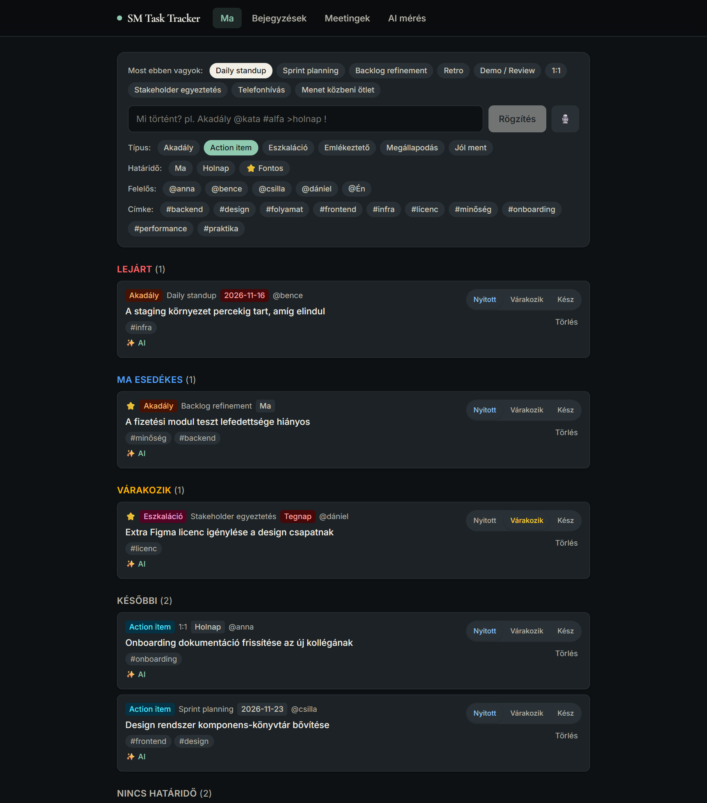
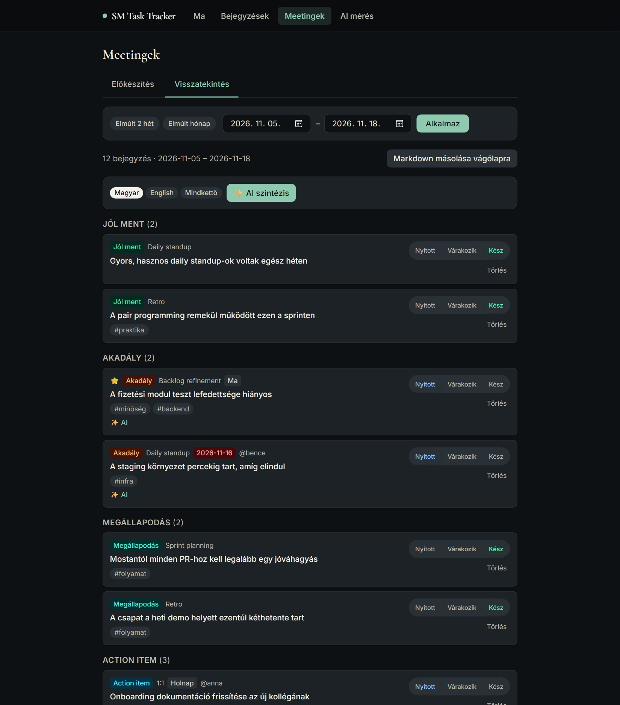
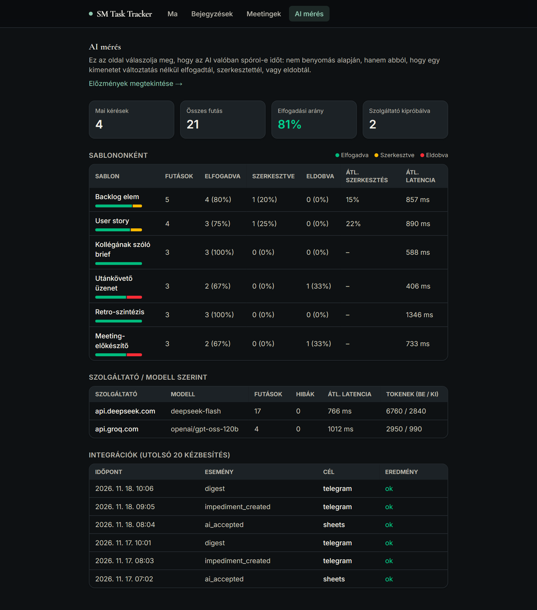
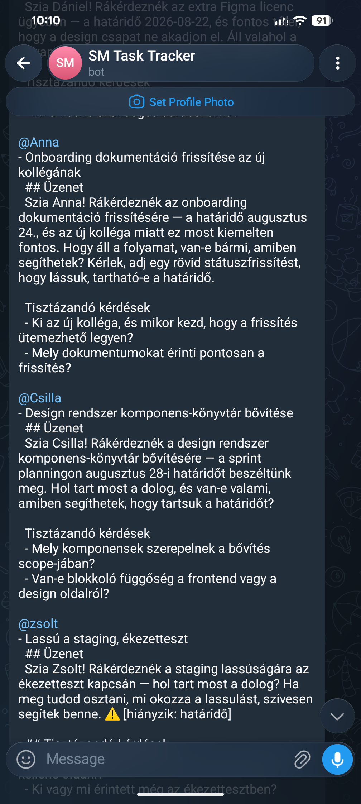
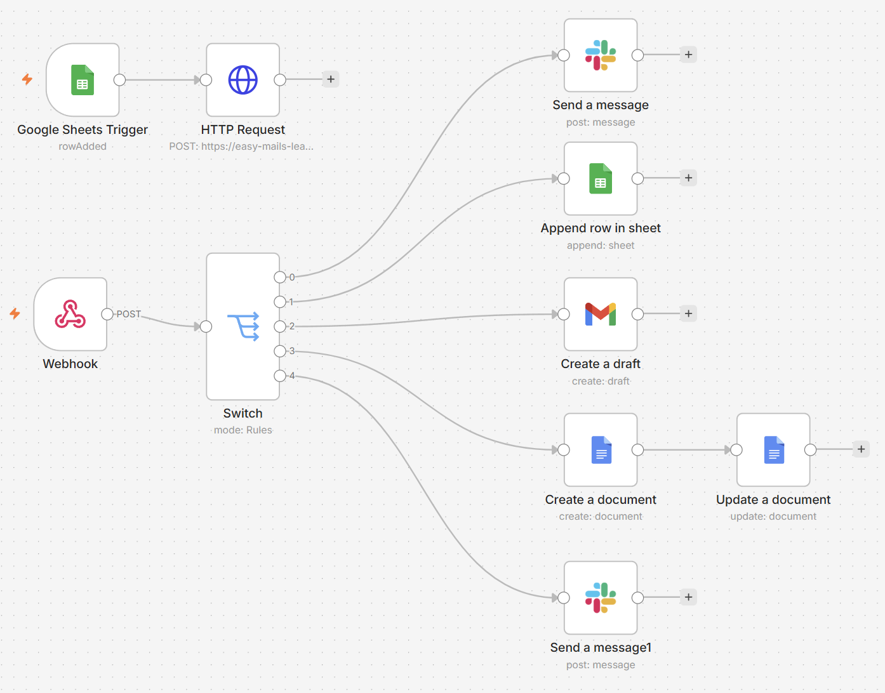

# SM Task Tracker

Egysoros gyorsrögzítő és mérési réteg agilis csapatvezetőknek — nem
Jira-pótlék, hanem egy jegyzet, amit egy meeting közben öt másodperc
alatt, egyetlen sorba írva rögzítesz, AI-val alakítasz belőle használható
artifaktot, és az app **méri**, hogy az AI ténylegesen spórol-e időt,
ahelyett hogy csak feltételeznénk.

Egyfelhasználós, saját használatra épített projekt, ami emellett teljes
körű technikai gyakorlatot mutat be: adatmodellezés, AI-integráció
provider-függetlenül, mérési réteg, biztonság és kimenő/bejövő
integrációk — **mostantól mind saját kóddal, külső automatizációs
platform nélkül**.

> **AI-asszisztált fejlesztés.** A projekt AI-asszisztált munkamenetben
> készült (Claude Code): én döntöttem a követelményekről, a
> kompromisszumokról és az ellenőrzésről, a kódot az AI-asszisztenssel
> együtt írtam, fázisonként, tesztekkel és átnézésekkel.

---

## Új szint: kódban megoldva, biztonságosan, rendezetten

A projekt első változata a külső kapcsolatokat (Slack, Google Sheets,
Gmail, Google Docs) egy n8n-es automatizációs platformra bízta. Ez gyorsan
működött, de az integrációk logikája az alkalmazáson kívül élt:
tesztelhetetlenül, verziókezelés nélkül, rejtett függőségként. A
következő szintre lépés lényege az volt, hogy **minden a kódba költözött**,
és közben három dolog javult érezhetően:

**1. Nincs többé automatizált bekötés, minden kód.** A kimenő és bejövő
integrációk a repóban élnek, tesztelhetők és verziókezeltek. Az n8n-es
változat archiválva van (lásd a lap alján), a működő állapota egy git
tagben megőrizve.

**2. Jobb biztonság.**
- Az éles demó jelszókapu mögé került, hibás konfigurációnál **zárva
  marad** (nem nyílik ki csendben).
- Belépés brute-force védelemmel, ami az adatbázisban él (szerver nélküli
  környezetben a memória nem marad meg), a próbálkozás atomikus számolásával.
- Minden Server Action **maga is ellenőrzi a munkamenetet**, és `zod`-dal
  validálja a bemenetet — a proxy védelme nem az egyetlen védvonal.
- A bejövő végpont (Google Form) **HMAC-SHA256 aláírással** védett, nem a
  jelszókapuval; az AI-promptok kikerültek a böngészőbe küldött kódból, és
  ezt automata teszt őrzi.
- A kritikus részeket (belépés, aláírás-ellenőrzés) külön biztonsági
  átnézésen is átment, ami valódi hibát talált és javíttatott.

**3. Rendezett API-kulcsok.** Az AI-réteg elsődleges szolgáltatója
DeepSeek, tartaléka és a hangátirat szolgáltatója Groq; a korábbi három
szolgáltató kulcsai megszűntek. Minden változó egy verziókövetett
`.env.example` mintában dokumentált (érték nélkül), a titkok párosával
kezelt kulcsok, a régi kulcsok visszavonva. Az `/insights` oldal
szolgáltatónként mutatja a futásokat és a hibákat.

**4. Jobb működési minőség.** 313 automata teszt (az átalakítás előtt 52),
fix `Europe/Budapest` időzónájú dátumkezelés (a "ma" nem csúszik el
éjfél után), atomikus adatbázis-írás, hangrögzítés-javítások (hibakezelés,
hossz- és méretkorlát), új sötét téma, mobilbarát elrendezés, és a
Retro meg a Meeting-előkészítő egyetlen **Meetingek** menübe rendezve.

---

## A probléma

Egy agilis csapatvezető munkanapja tele van elszórt jegyzettel — daily
közben felmerülő akadály, 1:1-en elhangzott teendő, retro utáni
megállapodás. Ezek vagy elvesznek, vagy külön eszközbe (jegyzetfüzet,
Slack DM magamnak) kerülnek, ahonnan sosem lesz belőlük backlog elem,
felelősnek szóló üzenet vagy megbeszélés-napirend.

## A megoldás

**Gyorsrögzítés egyetlen sorból**, beépített szintaxissal:

```
Akadály @kata #alfa-csapat >holnap !
```

— a `@` felelőst, a `#` címkét, a `>` határidőt, a `!` fontosságot jelöl,
kontextus-váltóval ("most ebben vagyok: daily / 1:1 / retro / …"), hogy
egy meeting alatt ne kelljen újra beállítani semmit.



---

## Meetingek: előkészítés és visszatekintés egy helyen

A `/meetings` menüben két fül van: **Előkészítés** (AI-napirend a
nyitott akadályokból és teendőkből) és **Visszatekintés** (retro,
időszak szerint, típusonként csoportosítva, AI-szintézissel és
markdown-exporttal).



---

## AI-réteg: nem "van AI", hanem *mérve van, hogy megéri-e*

Egy jegyzetből egy kattintással user story, backlog elem, kollégának
szóló feladatleírás vagy utánkövető üzenet lesz; retro nézetben egy
AI-szintézis emel ki témákat és ismétlődő akadályokat.

**A kulcsdöntés**: minden AI-kimenet egy review-panelen megy át
(szerkeszthető, Elfogadom/Eldobom) — az AI *soha* nem ír semmit
automatikusan az appba. Ez nemcsak biztonsági háló, hanem a mérés
alapja: minden döntés naplózódik (elfogadva / szerkesztve / eldobva,
mennyit változott a szöveg), így az `/insights` oldal adattal válaszolja
meg, hogy az AI ténylegesen időt spórol-e.

**Provider-független**: OpenAI-kompatibilis wire formátum, automata váltás
az elsődleges (DeepSeek) és a tartalék (Groq) között kvóta-, jogosultsági
vagy szerverhibánál. Minden futás a szolgáltató és modell nevével együtt
naplózódik, így az oldal azt is megmutatja, melyik modell válik be
jobban a saját jegyzeteken. Az oldal alján az integrációk utolsó
kézbesítései is látszanak.



**Hangrögzítés** ugyanerre az elvre épül: egy rövid felvételben elmondott
több megjegyzésből a rendszer külön candidate-bejegyzést készít
(típus, felelős, címke, határidő), candidate-onként Elfogadod vagy
Eldobod, a döntés a mérésbe kerül. Kétlépéses AI-hívás (Whisper-kompatibilis
átirat, majd strukturálás) áll mögötte.

---

## Natív integrációk (az n8n helyett)

Az események a `lib/integrations/` rétegen mennek ki: egy eseménytípus, egy
útvonal-sor és egy *sink* (cél) minden új kézbesítéshez. A kézbesítés a
mentés után, a háttérben fut (a rögzítést nem lassítja), a hibák egy
`integration_log` táblába kerülnek, és az `/insights` mutatja őket.

| Irány | Esemény | Cél |
|---|---|---|
| Ki | Akadály mentése | **Telegram** üzenet |
| Ki | Elfogadott backlog elem | **Google Sheets** sor (szervizfiókkal, külső csomag nélkül, saját JWT-aláírással) |
| Ki | Elfogadott meeting-előkészítő | **Telegram** üzenet |
| Ki | Napi összefoglaló | **Telegram**, Vercel Cron indítja |
| Be | Google Form (csapattagok akadálya) | **Apps Script** → HMAC-aláírt kérés → bejegyzés az appban |

### Telegram napi összefoglaló

A napi digest egyetlen üzenetben mutatja, **kinek mire kell
figyelnie**: minden felelőssel rendelkező nyitott vagy várakozó tételhez
az AI egy rövid, kész utánkövető üzenetet ír, az üzenet pedig @név szerint
csoportosítva, a lejártakkal kezdve áll össze. Telefonon, az app
megnyitása nélkül látszik, hogy ki mivel tartozik. A digest naponta egyszer
fut, és az `integration_log` őrzi, hogy lefutott-e.



### Google Form oldal

A csapattagok az app használata nélkül, egy Google Formon jelezhetnek
akadályt. A Form beküldésekor egy Apps Script a törzset tiszta ASCII
JSON-ként, `HMAC-SHA256(titok, időbélyeg + "." + törzs)` aláírással küldi
az app bejövő végpontjának. Az app ellenőrzi az aláírást és az
időbélyeget, a válasz-azonosító alapján idempotensen létrehozza az
Akadály bejegyzést, és Telegramon jelez. Az ékezetes szöveg aláírása a
karakterkódolástól független, mert a törzs `\uXXXX` formában utazik.

---

## Tech stack

- **Next.js 16** (App Router, Server Actions, Route Handlers) + TypeScript
- **Tailwind CSS v4**, saját sötét téma szemantikus tokenekkel
- **Drizzle ORM** + libSQL (SQLite lokálisan, [Turso](https://turso.tech) felhőben)
- **[Vitest](https://vitest.dev)** — 313 teszt (parser, dátumok, AI-futások, belépés, jogosultságok, HMAC, kliens-csomag őr)
- **[`openai`](https://github.com/openai/openai-node)** SDK (OpenAI-kompatibilis wire formátum) + **`zod`**
- **DeepSeek** (elsődleges) és **Groq** (tartalék, Whisper átirat)
- **Telegram Bot API**, **Google Sheets API**, **Google Apps Script**, **Vercel Cron**
- A fejlesztés AI-asszisztált módszerrel (Claude Code) készült.

---

## Élő demo

Van élesített, `Vercel + Turso` alapú változat kitalált demó-adatokkal —
jelszókapu mögött, nem publikus link, mert az AI-réteg kvótás, részben
fizetős API-kra épül. **Kérésre szívesen megmutatom élőben**, vagy
hozzáférést adok.

---

## Korábbi, lezárt fejlesztés: az n8n-alapú integráció

Az első változatban a külső kapcsolatok egy n8n-es automatizációs
platformon futottak: egy generikus, aláírt webhook-esemény, amelyre 6
workflow épült (Slack-riasztás, Google Sheet, Gmail-piszkozat, Google
Docs, meeting-előkészítő Slackre, Google Form → app). Érdekes tanulság
volt, hogy két workflow nulla app-kóddal készült el, igazolva, hogy egy
jól megtervezett esemény sok fogyasztót kiszolgál. Később kiváltottam
saját kóddal, mert így tesztelhető, verziókezelt és egy helyen kezelt a
logika, és kevesebb külső függőség marad. A működő n8n-es állapot az
`archive/n8n-integration` git tagben megmaradt.



A korábbi állapotok képernyőképei és README-i az [archívumban](archive/)
megtalálhatók, így a fejlődés lépései végigkövethetők.

---

*A fenti screenshotok egy demó-adatbázison készültek (kitalált nevek,
projektek, kitalált mérési és kézbesítési adatok) — a valós használatban
a jegyzetek természetesen a saját, privát munkámról szólnak.*
